# Mission Escape

A neon maze game written in **C++17** with **raylib 6.2**. You escape 20 levels of randomly
generated mazes, from the top-left start cell to the bottom-right exit, in a glowing top-down
view or in a **3D first-person** mode. Every image and sound is made in code: the game ships
with no art or audio files apart from one OFL font.

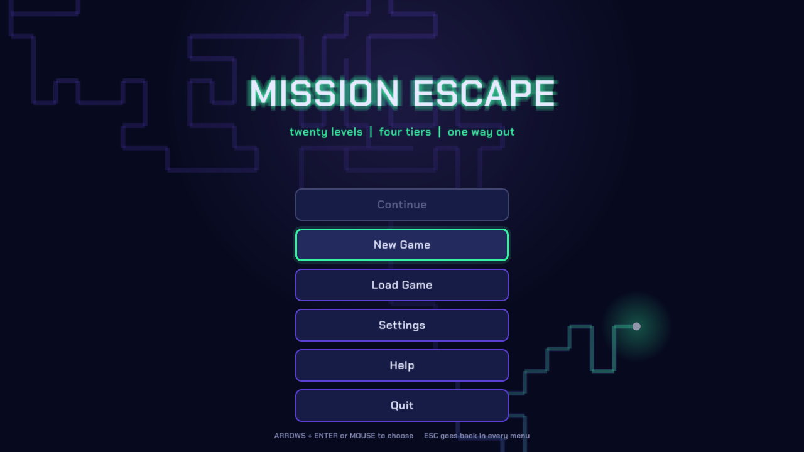

## Features

- **Random mazes every run.** An iterative recursive backtracker (DFS with an explicit stack)
  builds every maze. A seed regenerates the same maze exactly, so saves can resume a level.
- **Choose the size.** Mazes go from 10 × 10 to 50 × 50; you pick the size when starting a
  new game.
- **Four tiers, 20 levels:**
  - *Awakening:* classic perfect mazes.
  - *Labyrinth:* the hardest of 8 candidate mazes, with decoy branches next to the exit.
  - *Fog:* fog of war. You can't see through walls, and the map remembers where you've been.
  - *Hunted:* braided mazes with loops, plus a chaser that recomputes its BFS path every step.
- **Secret doors.** Green runes mark walls you can walk through. Each one is checked with BFS
  to make sure it shortens the way to the exit.
- **Perks:**
  - Magic Berry (phase through walls)
  - Hourglass (freezes the timer)
  - Compass Spark (lights the shortest path)
  - Lantern (doubles sight in the fog)
  - Frost Shard (freezes the chaser)
- **Stars and records.** Each level has a par time; you earn 3, 2 or 1 stars. The best stars
  and best time are saved for every level.
- **Five animated skins:** Wisp, Prism, Comet, Phantom and Nova. They unlock at levels 5, 10,
  15 and 20.
- **3D first-person mode.** All walls are one mesh, with GLSL distance fog, a minimap and
  smooth turns.
- **Text view** (`T`). Shows the maze as ASCII, produced by the pure function
  `core::mazeToText`.
- **Three save slots.** Saves are validated key=value files, written atomically. **Save & Exit**
  resumes the level exactly where you left it.
- **Procedural audio.** 11 synthesised sound effects, plus a seamless ambient loop for each tier.
- **Full mouse and keyboard support** in every menu.

## Screenshots

| | |
|---|---|
| 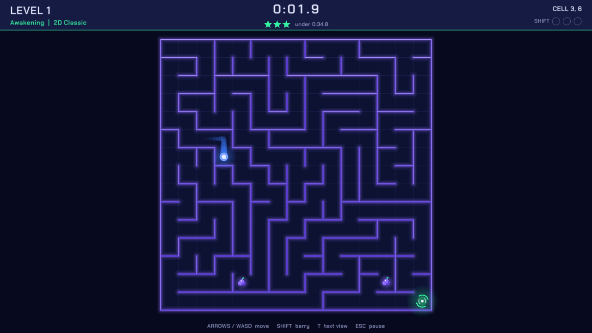 | 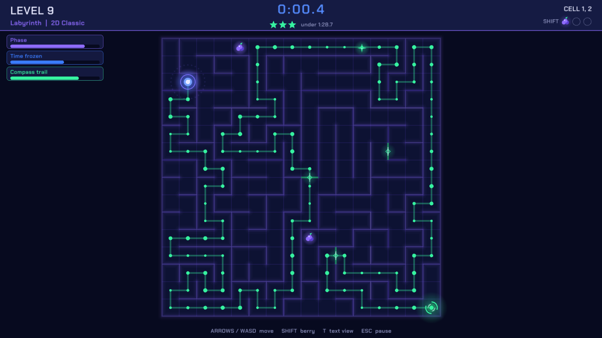 |
| 2D Classic, tier 1 | Magic Berry phase, Compass Spark trail, Hourglass |
| 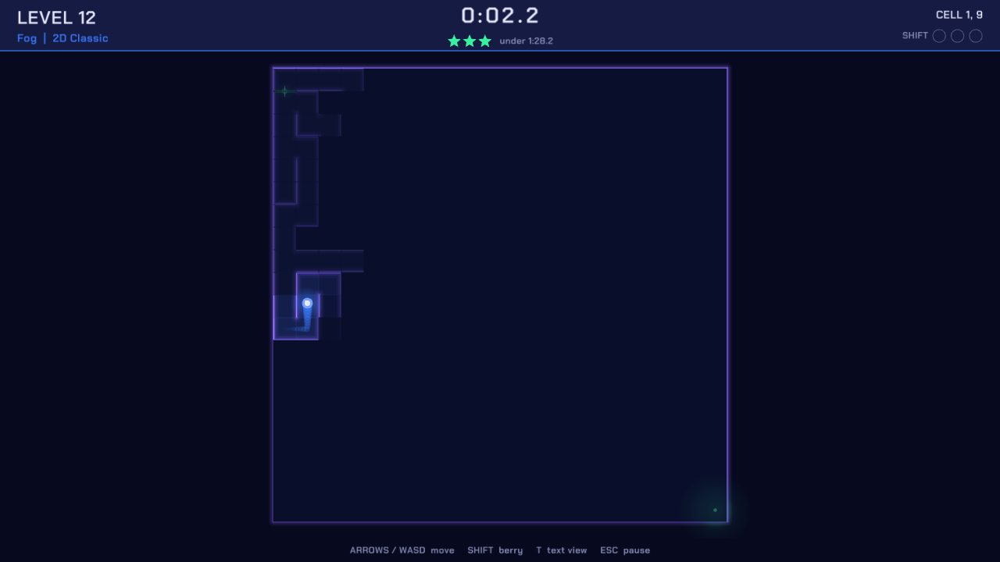 | 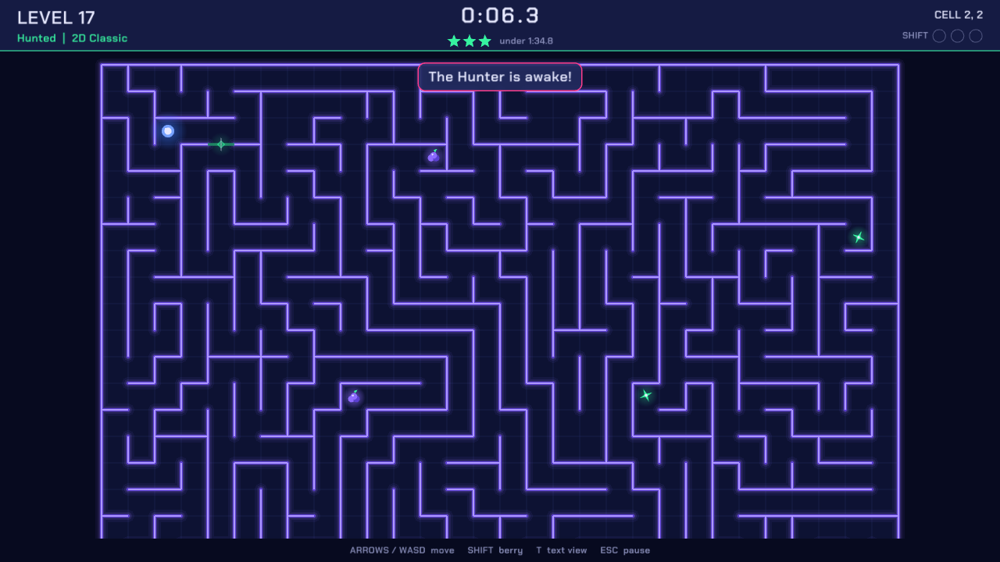 |
| Tier 3: fog of war | Tier 4: braided maze and the Hunter |
| 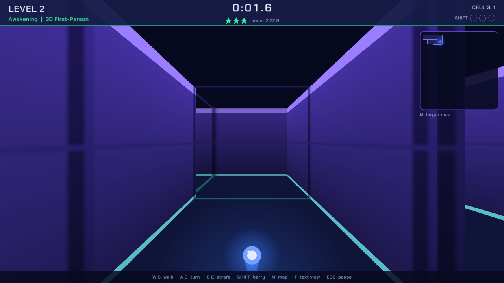 | 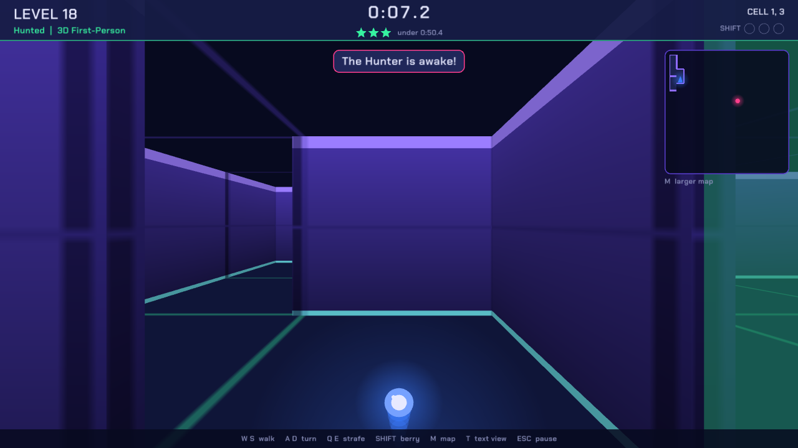 |
| 3D first-person mode with minimap | 3D, tier 4, with a secret door on the right |
| 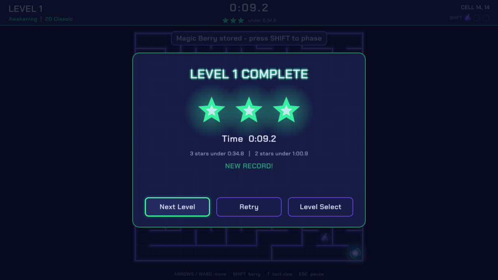 | 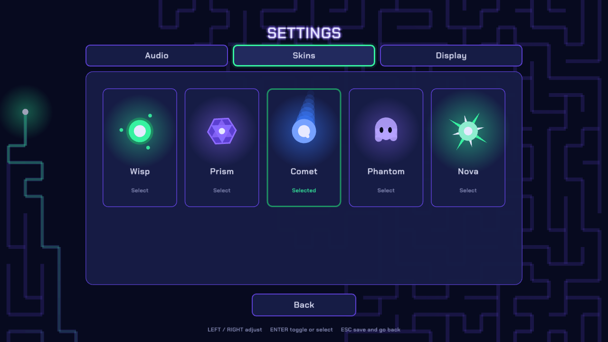 |
| Animated star reveal | Settings → Skins |
| 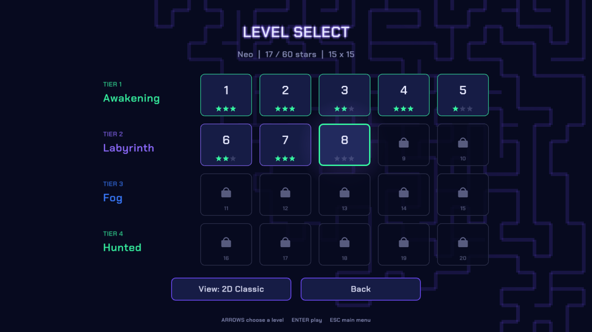 | 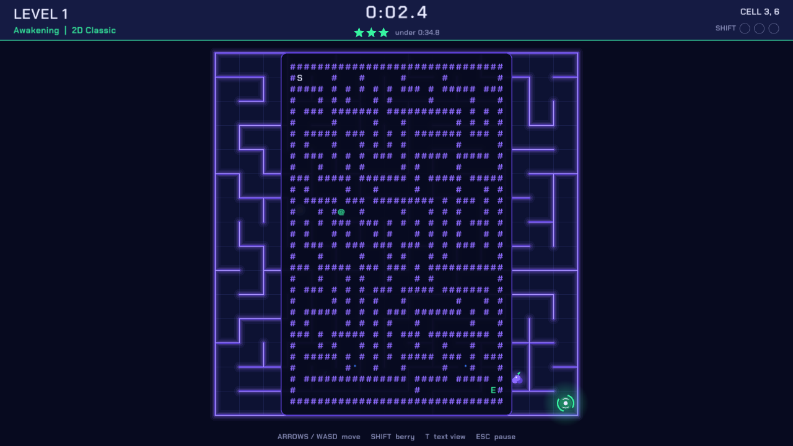 |
| Level select | ASCII text view (`T`) |

`maze_game --screenshots` regenerates all of these. It walks through the game automatically
and writes the PNGs to `./screenshots/`.

## Controls

| Action | 2D Classic | 3D First-Person |
|---|---|---|
| Move | Arrow keys / WASD | W / ↑ forward, S / ↓ back |
| Turn | – | A D / ← → (90°) |
| Strafe | – | Q / E |
| Magic Berry (phase) | Shift | Shift |
| Text view | T | T |
| Minimap size | – | M |
| Pause | Esc / P | Esc / P |
| Cell info | Hover the mouse | – |
| Menus | Arrow keys + Enter, Esc = back, or the mouse | same |

## Building

You need **CMake ≥ 3.20**, a C++17 compiler and an internet connection the first time you
configure: CMake downloads raylib 6.2, pinned by URL and SHA-256. Warnings are treated as
errors by default (`-DMISSION_ESCAPE_WARNINGS_AS_ERRORS=OFF` turns this off).

### Windows: Visual Studio 2022 / 2026 (MSVC)

```bash
cmake -S . -B build -G "Visual Studio 17 2022" -A x64
```
```bash
cmake --build build --config Release
```
```bash
ctest --test-dir build -C Release --output-on-failure
```
```bash
build\Release\maze_game.exe
```

With Visual Studio 2026, use the generator `"Visual Studio 18 2026"`. You can also open the
folder in Visual Studio ("Open Folder"); it picks up `CMakeLists.txt` automatically. The
Release build is a windowed application with no console.

### Windows: MinGW-w64 (e.g. MSYS2 UCRT64)

```bash
cmake -S . -B build -G "MinGW Makefiles" -DCMAKE_BUILD_TYPE=Release
```
```bash
cmake --build build -j
```
```bash
ctest --test-dir build --output-on-failure
```

### Linux (GCC or Clang)

Install the raylib build dependencies (Debian/Ubuntu shown):

```bash
sudo apt install build-essential cmake libasound2-dev libx11-dev libxrandr-dev libxi-dev libgl1-mesa-dev libglu1-mesa-dev libxcursor-dev libxinerama-dev libwayland-dev libxkbcommon-dev
```
```bash
cmake -S . -B build -DCMAKE_BUILD_TYPE=Release
```
```bash
cmake --build build -j
```
```bash
ctest --test-dir build --output-on-failure
```
```bash
./build/maze_game
```

### Targets

| Target | What it is |
|---|---|
| `maze_core` | Static library: `src/core` (pure C++, no raylib, no iostream) and `src/io` (save files) |
| `maze_game` | The game executable |
| `maze_tests` | 126 unit tests in 16 suites, registered with CTest |

Saves are stored in `saves/slot1..3.sav` and settings in `settings.cfg`, both next to the
executable.

## Project layout

```
src/core    game rules: Grid2D, Maze, generator, BFS, Level, Fog, Chaser, perks, scoring...
src/io      save slots and settings files
src/render  palette, 2D/3D renderers, HUD, minimap, skins, effects
src/ui      widgets and one class per screen
src/audio   synthesiser and audio manager
src/app     App (main loop), screen state machine, GameSession, input, screenshot tour
tests       self-written test harness and test suites
docs        rules, technical notes, algorithms, QA, standards, backlog, presentation
```

## Documentation

- [Game rules](docs/GAME_RULES.md)
- [Technical documentation](docs/TECHNICAL.md)
- [Algorithms (Mermaid flowcharts)](docs/ALGORITHMS.md)
- [QA: test plan and results](docs/QA.md)
- [Coding standards](docs/CODING_STANDARDS.md)
- [Implementation plan and decisions](docs/PLAN.md)
- [Backlog](docs/BACKLOG.md)
- [Presentation outline](docs/PRESENTATION_OUTLINE.md)

## Author

YMYanakiev24

**How this was built:** YMYanakiev24 wrote the prompts that specify the project. The code and docs
were written by Claude (Anthropic's AI) from those prompts.

## Credits and licences

- [raylib](https://www.raylib.com/) by Ramon Santamaria and contributors (zlib licence).
- Font: [Chakra Petch](https://github.com/m4rc1e/Chakra-Petch) by the Chakra Petch Project
  Authors, SIL Open Font License 1.1 (`assets/fonts/OFL.txt`). If the font file is missing,
  the game falls back to raylib's built-in font.
- Every other graphic and sound is generated procedurally by the game.
