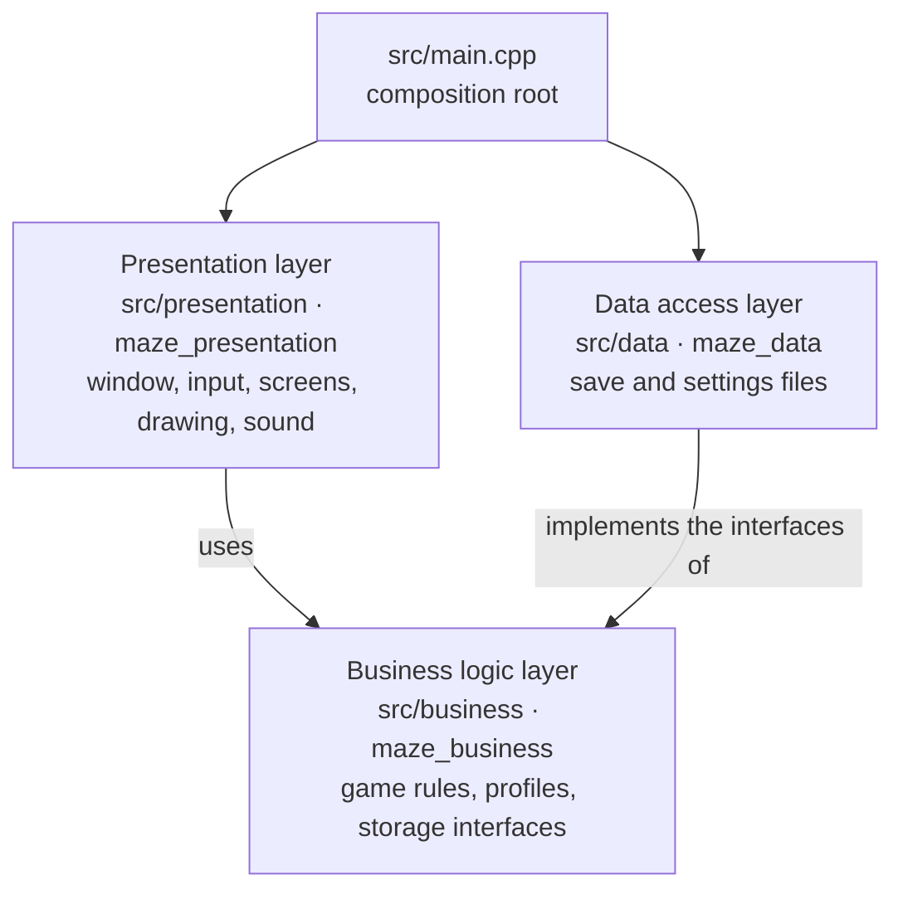

# Mission Escape

A maze game written in C++17 with [raylib](https://www.raylib.com/), built on a **three-layer
architecture**. The player starts in the top-left cell (0, 0) of an N × N maze (10 ≤ N ≤ 50)
and has to reach the exit in the bottom-right cell. The campaign has 20 levels in 4 tiers, and
every level can be played in a 2D top-down view or a 3D first-person view.

## Team

We are a team of four students from class 10V.

| Name | Role |
|---|---|
| Yanko Yanakiev | Scrum Trainer |
| Kristiyana Ivanova | Frontend Developer |
| Denis Paspalov | Backend Developer |
| Vanessa Tsenova | Backend Developer |

## Tools and technologies

| Tool | Used for |
|---|---|
| C++17 | The language of the whole game |
| Visual Studio 2026 | IDE, MSVC compiler and debugger |
| CMake | Building the three layers, the game and the tests |
| raylib 6.2 | Window, input, 2D and 3D graphics, sound |
| Git | Version control and commit history |
| GitHub | Repository, issues and planning |
| Microsoft Teams | Team communication and the assignment |
| clang-format | Consistent code formatting |
| Claude AI (Anthropic) | Help on the project and with the graphics library (see [Credits](#credits)) |

## Features

- **20 levels in 4 tiers**, each adding a rule:

  | Tier | Levels | New rule |
  |---|---|---|
  | Awakening | 1–5 | Classic perfect maze: exactly one route to the exit |
  | Labyrinth | 6–10 | Longer routes, decoy branches near the exit, secret doors |
  | Fog | 11–15 | Fog of war: you only see a few cells around you |
  | Hunted | 16–20 | A maze with loops and a Hunter that chases you |

- **2D and 3D views** driven by the same game logic.
- **Maze generation** with depth-first search and **pathfinding** with breadth-first search.
- **Secret doors** that always shorten the way to the exit.
- **Five perks**: Magic Berry, Hourglass, Compass Spark, Lantern and Frost Shard.
- **Stars** for fast times, the personal best in the HUD and a step counter on the results screen.
- **Three save slots**, autosave, and Save & Exit in the middle of a level.
- **Keyboard, mouse and gamepad** controls.
- **Text view** (T): the maze as ASCII text, seen from above.
- **Procedural graphics and sound**: no image or audio files apart from the font.
- **138 unit tests in 17 suites** with a self-written test harness.

## Assignment requirements

| # | Requirement | Where it is met |
|---|---|---|
| 1 | A maze game the player wins by getting through | `Level` (src/business/core) |
| 2 | Dynamic arrays; size 10×10 to 50×50, chosen when a game starts | `Grid2D` (`new[]`/`delete[]`), New Game wizard, `validateMazeSize` |
| 3 | Start at (0, 0) top-left, exit bottom-right | `Maze::start()`, `Maze::exit()` |
| 4 | The maze is shown with the player's position after every move | `Renderer2D`, `Renderer3D`, HUD |
| 5 | A text view of the maze from above | Text View (T), `mazeToText` |
| 6 | Walls, openings and the exit are visible | 2D, 3D and text views |
| 7 | A new maze every time the program runs | random seed per attempt (`makeRandomSeed`) |
| 8 | Arrow keys; no moving through walls except a special door that shortens the way | `Input`, `Maze::canPass`, `placeSecretDoors` |
| 9 | Functions that maintain and draw the maze | `Maze`, `MazeGenerator`, renderers |
| 10 | Game-logic functions do not use standard input/output | the business layer has no I/O; no `cin`/`cout` anywhere in `src` |
| 11 | A menu | Main Menu, pause menu |
| 12 | Validation of user input | `Validation.cpp` (size, name, slot) and save-file checks |

Details and tests for each requirement: [docs/QA.md](docs/QA.md#requirement-traceability).

## Three-layer architecture



| Layer | Folder | CMake target | Responsibility |
|---|---|---|---|
| Presentation | `src/presentation` | `maze_presentation` | Window, input, screens, 2D/3D drawing, audio (raylib) |
| Business logic | `src/business` | `maze_business` | Maze, generation, BFS, level rules, scoring, progress, profiles |
| Data access | `src/data` | `maze_data` | Reading and writing `saves/slotN.sav` and `settings.cfg` |

Every layer is its own library and only sees the headers of the layers it may use, so a
wrong-way dependency does not compile. See [docs/ARCHITECTURE.md](docs/ARCHITECTURE.md).

## Building and running

You need CMake 3.20+ and a C++17 compiler (tested with Visual Studio 2026 / MSVC). The first
configure downloads raylib 6.2, so it needs an internet connection.

```bash
cmake -S . -B build
cmake --build build --config Release
ctest --test-dir build -C Release
```

The game is `build/Release/maze_game.exe` (Windows, Visual Studio generator). Saves and settings
are stored next to the executable. `maze_game --screenshots` walks through the screens by itself
and writes PNG captures to `screenshots/` without touching your saves.

More in [docs/DEVELOPMENT.md](docs/DEVELOPMENT.md).

## Controls

| Action | 2D | 3D | Gamepad |
|---|---|---|---|
| Move | Arrow keys / WASD | W / S forward and back | D-pad or left stick |
| Turn | – | A / D | D-pad or stick left/right |
| Strafe | – | Q / E | LB / RB |
| Use a Magic Berry | Shift | Shift | X or RT |
| Text view | T | T | Y |
| Larger/smaller minimap | – | M | LT |
| Restart the level | R | R | Select |
| Pause | Esc / P | Esc / P | Start |

The full game description and rules: [docs/GAME_RULES.md](docs/GAME_RULES.md).

## Project structure

```
src/
  main.cpp            composition root: wires the three layers together
  presentation/       presentation layer
    app/              main loop, screen stack, input, game session
    ui/               screens and widgets (buttons, sliders, text fields)
    render/           2D and 3D rendering, HUD, minimap, effects, fonts
    audio/            sound synthesis and the audio manager
  business/core/      business logic layer: rules, algorithms, profiles
  data/io/            data access layer: key=value format, save slots, settings
tests/                unit tests (17 suites)
assets/fonts/         the Chakra Petch font
docs/                 documentation
```

## Documentation

- [docs/GAME_RULES.md](docs/GAME_RULES.md) – description of the game and its rules.
- [docs/TECHNICAL.md](docs/TECHNICAL.md) – technical implementation, area by area.
- [docs/ARCHITECTURE.md](docs/ARCHITECTURE.md) – the three layers, dependencies and data flow.
- [docs/ALGORITHMS.md](docs/ALGORITHMS.md) – maze generation, BFS, fog, the Hunter, scoring, saving.
- [docs/QA.md](docs/QA.md) – QA documentation: every test function, the manual checklist and
  requirement traceability.
- [docs/DEVELOPMENT.md](docs/DEVELOPMENT.md) – building, testing and extending the project.

## Credits

How the project was built and which third-party resources it uses is recorded in
[CREDITS.md](CREDITS.md): YMYanakiev24 wrote the prompts that specify the project, and the code
and docs were written by Claude (Anthropic's AI) from those prompts. Third-party resources are
raylib (zlib licence) and the Chakra Petch font (SIL Open Font License).
