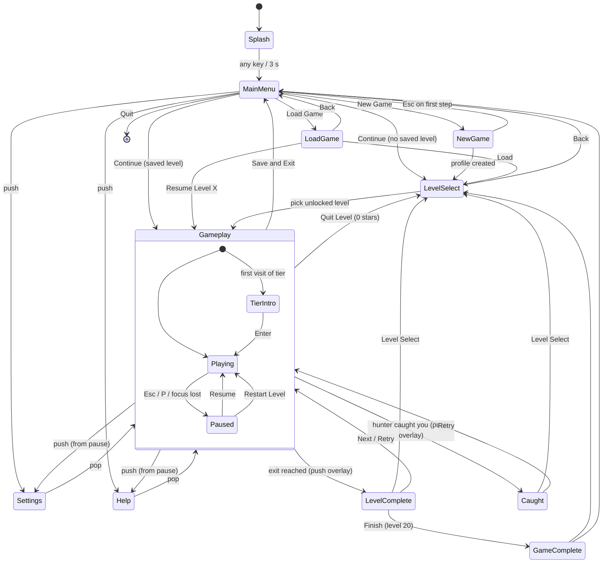
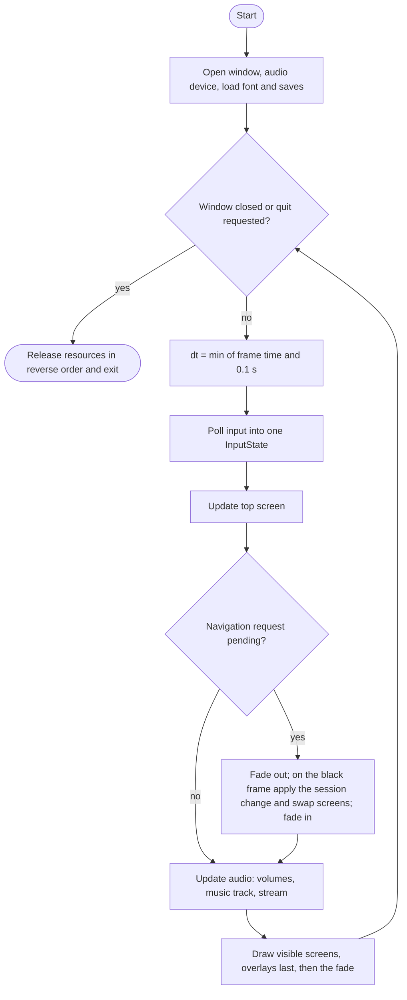
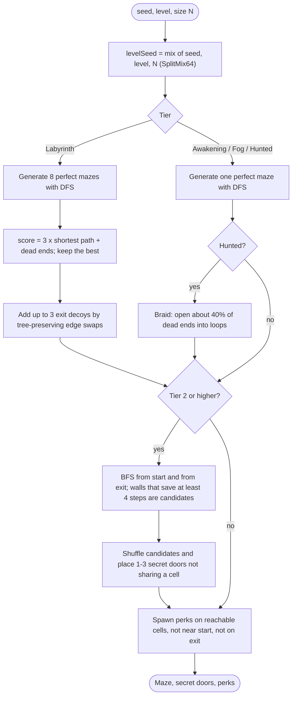
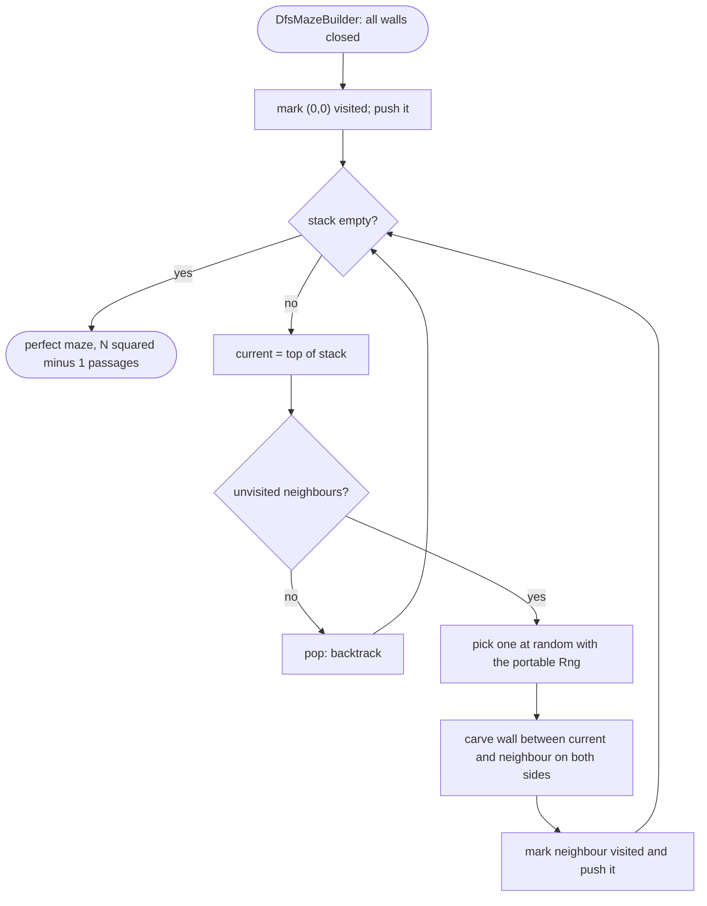
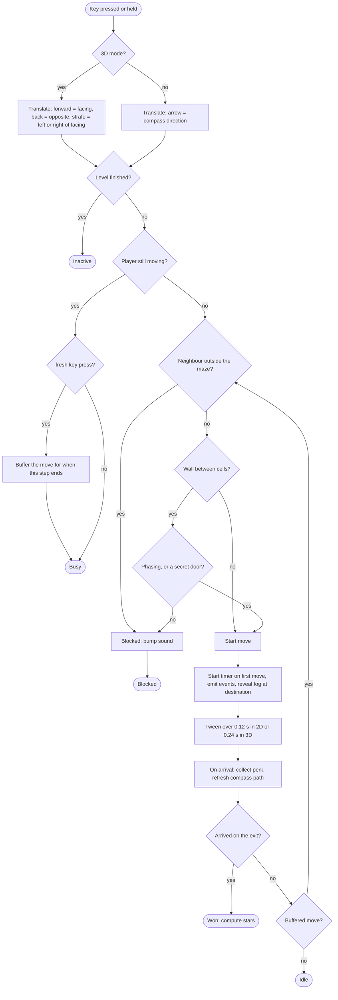
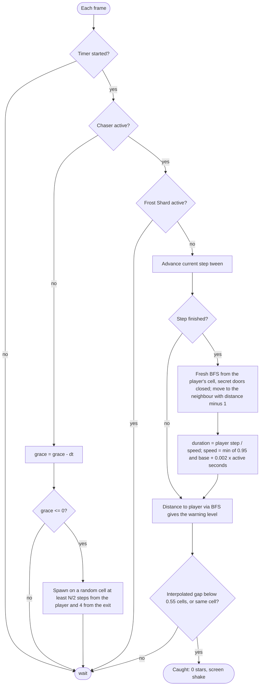
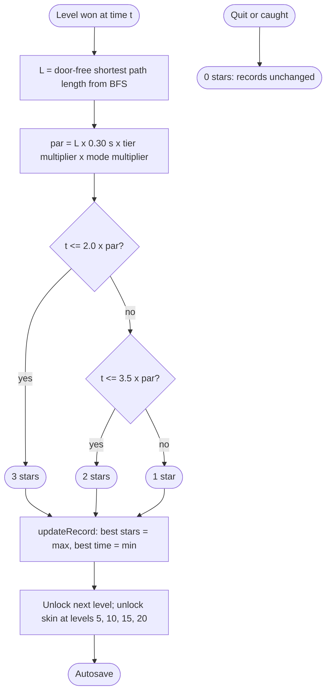
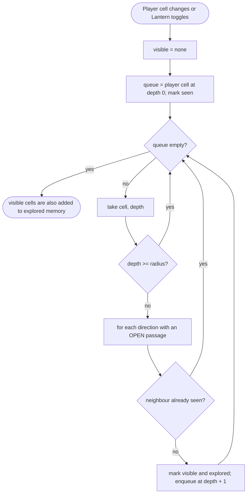

# Mission Escape: Algorithm Flowcharts

These Mermaid diagrams are the algorithmic scheme of the project. GitHub renders them directly;
they can also be pasted into <https://mermaid.live>.

## 1. Screen state machine and main loop

## 2. Maze generation for a level

## 3. Move and collision resolution

## 4. Chaser step (tier 4)

## 5. Star calculation

## 6. Fog of war visibility

