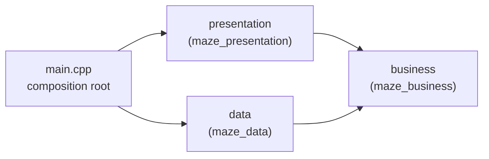

# Architecture

Mission Escape is split into three layers. Each layer is a separate static library in CMake with
one clear responsibility. This document describes what each layer contains, which way the
dependencies point, how the build enforces them and how data flows between the layers.

## The three layers

| Layer | Folder | CMake target | Namespaces | Responsibility |
|---|---|---|---|---|
| Presentation | `src/presentation` | `maze_presentation` | `app`, `ui`, `render`, `audio` | Everything the player sees, hears and presses |
| Business logic | `src/business` | `maze_business` | `core` | Game rules, algorithms and profile management |
| Data access | `src/data` | `maze_data` | `io` | Reading and writing files |

### Presentation layer (`src/presentation`)

The only layer that uses raylib.

- `app/` – `App` (main loop), `AppContext` (services shared by the screens), `ScreenStack`
  (screen state machine), `Input` (keyboard, mouse, gamepad), `GameSession` (connects one level
  to rendering and input), `FeedbackPresenter` (turns level events into sound and effects),
  `ScreenshotTour` (the `--screenshots` mode).
- `ui/` – the 11 screens and the widgets (`Button`, `Slider`, `Toggle`, `TextField`,
  `FocusGroup`).
- `render/` – 2D and 3D renderers, HUD, minimap, effects, theme and font, GPU resources.
- `audio/` – procedural sound synthesis (`Synth`) and the `AudioManager`.

The presentation layer **makes no rule decisions**: it sends commands to the business layer (for
example `Level::tryMove`) and shows the result.

### Business logic layer (`src/business`)

Plain C++ without raylib and without files, so it is fully tested without a window.

- Maze model: `Cell`, `Grid2D`, `Maze`.
- Algorithms: `MazeGenerator` (DFS and tier rules), `Pathfinding` (BFS), `Fog`, `Chaser`,
  `TextView`.
- Level simulation: `Level`, `Player`, `Perks`, `LevelRules`, `LevelSnapshot`.
- Scoring and progress: `Scoring`, `Progress`.
- Input checks: `Validation`. Settings: `Settings`. Tuning values: `Config.h`.
- Profiles: `ProfileService` – which slot is active, what a finished level changes, when data is
  saved.
- Contract with the data layer: `Repositories.h` – the `SaveRepository` and `SettingsRepository`
  interfaces.

### Data access layer (`src/data`)

- `KeyValueDocument` – the `key=value` text format, strict parsing and safe (atomic) file
  writing.
- `SaveSystem` – the three slots `saves/slotN.sav`; implements `core::SaveRepository`.
- `SettingsStore` – the `settings.cfg` file; implements `core::SettingsRepository`.

## Dependency direction



- The presentation layer depends only on the business layer (and raylib).
- The data layer depends only on the business layer: it **implements** its interfaces and stores
  its models (`SaveData`, `Settings`, `LevelSnapshot`).
- The business layer depends on nothing but the standard library.

This is a three-layer architecture with **dependency inversion** between the business and data
layers. The business layer states what it needs ("save this profile") through an interface, and
the data layer decides how (a text file written atomically). As a result:

1. the business logic never sees a file and is tested with in-memory repositories
   (`tests/test_profiles.cpp`);
2. there is no circular dependency, even though the data layer must know the models it stores;
3. the file format can change without touching the logic or the interface.

## How the build enforces the boundaries

Each CMake target only gets the header folders of the layers it may use:

| Target | Sees |
|---|---|
| `maze_business` | `src/business` |
| `maze_data` | `src/data`, `src/business` |
| `maze_presentation` | `src/presentation`, `src/business` (+ raylib) |
| `maze_game` (`main.cpp`) | all three |

If a presentation file tries `#include "io/SaveSystem.h"`, compilation stops with error C1083
("Cannot open include file"). If a business file tries to include raylib or another layer, it
does not compile either. The architecture is not just a convention.

## Composition root

`src/main.cpp` is the only place that knows all three layers. It creates the concrete data-layer
storage and hands it to the presentation layer as business-layer interfaces:

```cpp
int main(int argc, char* argv[]) {
    const std::filesystem::path dataDirectory(GetApplicationDirectory());
    io::SaveSystem saves(dataDirectory / "saves");
    io::SettingsStore settingsStore(dataDirectory / "settings.cfg");
    app::App application(app::parseLaunchOptions(argc, argv), saves, settingsStore);
    return application.run();
}
```

`App` passes the storage to `AppContext`, which passes it to `core::ProfileService`. Screens
reach profiles and settings only through `m_context.profiles`.

## Data flow examples

### Starting the game

1. `main.cpp` creates `io::SaveSystem` and `io::SettingsStore`.
2. `App::run()` opens the window and creates the `AppContext`.
3. `context.profiles.loadAll()` (business) calls `SettingsRepository::load()` and
   `SaveRepository::load()` for the three slots.
4. `SaveSystem::load()` (data) reads the file, checks every field and returns a `LoadResult`
   with the status Ok, Missing or Corrupt.
5. The Load Game screen (presentation) shows the slots from `profiles.slots()`.

### One player step

1. `Input` (presentation) turns the key into `GameAction::Up`.
2. `GameSession` calls `Level::tryMove(Direction::North)` (business).
3. `Level` checks the wall with `Maze::canPass` and starts the move. In the following frames
   `Level::update()` moves the player, updates the fog and the Hunter and adds events (`Moved`,
   `PerkCollected`, …).
4. `GameSession` takes the events and `FeedbackPresenter` plays a sound and spawns particles.
5. `Renderer2D` or `Renderer3D` draws the new state.

### A finished level

1. `Level` reaches the exit and computes the stars (`Scoring`).
2. `GameplayScreen` calls `AppContext::recordLevelResult()`.
3. `ProfileService::recordResult()` (business) applies the result to `Progress`, drops the saved
   attempt and calls `saveActiveProfile()`.
4. `SaveRepository::save()` → `SaveSystem` (data) serialises the profile as `key=value` and writes
   it atomically (temporary file + rename).
5. The Level Complete screen shows the time, stars, record and route.

## Where new code goes

| Change | Layer |
|---|---|
| A new rule, perk or algorithm | business (`src/business/core`) |
| A new save field or file format | data (`src/data/io`); the model stays in the business layer |
| A new screen, widget, effect or sound | presentation (`src/presentation`) |
| A new kind of storage (in memory, a database…) | a class that implements `SaveRepository`, chosen in `main.cpp` |
